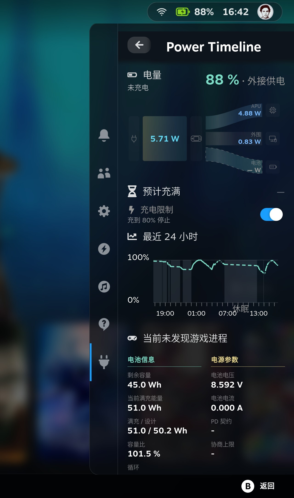

<h1 align="center">Power Timeline</h1>

> “Has my Steam Deck’s battery lost capacity? How much can it hold on a full charge now?”
>
> “Where did all my battery charge go? How much drained while the Deck was idle, and how much did gaming use?”

Power Timeline is a Decky plugin for Steam Deck. It lets you compare the battery’s full-charge capacity with its design capacity and puts battery level, game activity, and sleep periods on a single timeline. See how much energy your battery can hold now, then look back at when its charge was used. Recording continues after you close the page.

<p align="center">
  <a href="./README.md">English</a> · <a href="./README.zh-CN.md">简体中文</a> · <a href="./README.pt.md">Português</a> · <a href="./README.es.md">Español</a> · <a href="./README.ja.md">日本語</a> · <a href="./README.ko.md">한국어</a>
</p>
<p align="center">
  <a href="#what">What you see</a> · <a href="#install">Install</a> · <a href="#try-it">First use</a> · <a href="#limits">Please note</a> · <a href="#language">Language</a> · <a href="./CHANGELOG.md">Changelog</a>
</p>
<p align="center">
  
</p>

This picture is the Quick Access menu while the Deck is plugged in. It shows the current battery, the small power-flow picture, the last 24 hours, and battery details. The watt figures in the picture are not whole-device power.

<h2 id="what">What you see</h2>

**How much can the battery hold now?**

Compare the current full-charge capacity, design capacity, and capacity ratio for a reference when checking for capacity loss. This is about how much the battery can hold when full, not how much charge is left right now.

**How does the battery drain while idle and while gaming?**

Look back over the last 1, 3, or 7 days of battery level alongside game activity, power-source changes, and sleep periods to see when the charge dropped and what was happening then. For sleep periods, you can compare the battery levels before and after sleep; there is no continuous sampling or energy calculation during that interval. Game history also shows each game’s energy estimate.

The Quick Access menu (QAM) also shows the current battery level, a small power-flow picture, and battery details, and lets you turn Steam’s charge limit on or off. While charging, when the system provides an estimate, you can also see about how long until full.

<h2 id="install">Install</h2>

### Install Decky first

If Decky is not installed, follow the official [Decky Loader](https://github.com/SteamDeckHomebrew/decky-loader#installation) instructions. The same instructions are on the [wiki](https://wiki.deckbrew.xyz/en/user-guide/install).

### Download the package

Open the [latest release](https://github.com/ZacharyQin/power-timeline/releases/latest). Download the asset whose name starts with `power-timeline-` and ends with `.zip`. Do not download Source code (zip). That archive is the source tree, and Decky cannot install it.

If you downloaded the ZIP on another computer, copy it onto the Steam Deck.

### Install it in Decky

The menu names below are the English labels in Decky's interface. This plugin is not in the store, so it has to be installed from a ZIP.

1. Press the Quick Access button, open the Quick Access menu, and move to the plug icon. The title should say Decky. If a plugin is already open, press the arrow on the left of the title until it says Decky.
2. Select the gear. Its hint is "Open Decky Settings".
3. Open General. Under Other, turn on Developer mode.
4. Developer then appears in the list on the left. Open it.
5. Under Third-Party Plugins, find Install Plugin from ZIP File and select Browse.
6. The dialog says the Decky team has not reviewed this plugin. The first time, wait about 5 seconds before you can continue.
7. Select the ZIP whose name starts with `power-timeline-`.

After it is installed, go back to the list under the plug icon and open **Power Timeline**.

The backend runs as root so it can read hardware. It does not change system power policy by itself, and it does not change other plugins.

### Update and uninstall

To update, download the new `power-timeline-` ZIP from the same latest-release page and install it again with the steps above.

Uninstall from Plugins in Decky's settings. Uninstalling does not delete history. History is usually in `~/homebrew/data/power-timeline/`. To clear the history as well, you can delete that data directory.

<h2 id="try-it">First use</h2>

1. Open the Quick Access menu, move to the plug icon, and select **Power Timeline**.
2. Move focus to Last 24 hours and press the confirm button (A) to open the battery timeline.
3. At the top of the page, select Last 1 day, Last 3 days, or Last 7 days. Move focus onto the curve and use left and right to look at a moment. The chart shows battery and power then. If a game was being recorded, its icon and name are shown.
4. Select Game history.
5. Back in the Quick Access menu, focus the small power-flow picture and press confirm to open power flow. Focus Battery and press confirm to open power and battery.

The first time it is turned on, there is no earlier history. Use from before it was enabled is not filled in.

<details>
<summary>Touchscreen and other controls</summary>

- Tap Last 24 hours to open the timeline. Tap the small power-flow picture to open power flow. Tap Battery to open power and battery.
- Left and right on the 24-hour chart in the Quick Access menu only place a temporary marker. They do not open the timeline.
- On the timeline curve, a sideways drag selects a moment. A tap that does not slide does not.

</details>

<h2 id="limits">Please note</h2>

- Whole-device power is available only when battery discharge is confirmed. While plugged in, it is unknown. Charge power, net battery power, and APU power are not used instead.
- Game energy is an estimate. Two games running at once do not each receive the whole-device total.
- A missing number stays unknown. It is not shown as 0. Time to full comes from the system's estimate. It is not an exact countdown.
- The charge limit only toggles Steam's existing switch. The percentage is still changed in Steam.
- Records stay on the device. They are not uploaded.
- Tried on one Steam Deck (Galileo). Other models are unverified.

<details>
<summary>What the energy estimate includes</summary>

The game-energy estimate covers CPU and GPU energy that can be split by process activity. It is not the whole-device energy of running that game. It does not include the screen, the separately read SoC power, or system use that was not assigned to the game.

</details>

<h2 id="language">Language</h2>

It follows Steam's interface language until you choose one.

You can choose Simplified Chinese, English, Portuguese, Spanish, Japanese, and Korean. A row of flags sits at the bottom of the Quick Access menu and of every full page. Left, right, or a sideways swipe only moves the highlight. Confirm switches the language. The hint uses that flag's language. The choice is remembered.

This document is in the same six languages. Use the links at the top.

<details>
<summary>How Steam languages map</summary>

| Flag | Interface | Steam language |
| --- | --- | --- |
| China | Simplified Chinese | Simplified, Traditional, and other Chinese |
| United States | English | English, and any language not listed below |
| Portugal | Portuguese | Portuguese and Brazilian Portuguese share this text |
| Spain | Spanish | Spanish and Latin American Spanish share this text |
| Japan | Japanese | Japanese |
| South Korea | Korean | Korean |

</details>

<details>
<summary>Build from source</summary>

Node.js, pnpm, and Python 3 are required.

```sh
pnpm install --registry=https://registry.npmjs.org
pnpm typecheck
pnpm build
python3 -m unittest discover -s tests -v
```

`pnpm build` writes the frontend. Pack the runtime files into the ZIP. Do not put the database in the plugin directory.

</details>

## License

[BSD 3-Clause](./LICENSE). Copyright (c) 2026, Zachary. This is an independent plugin, not an official Valve, SteamOS, or Decky project.
