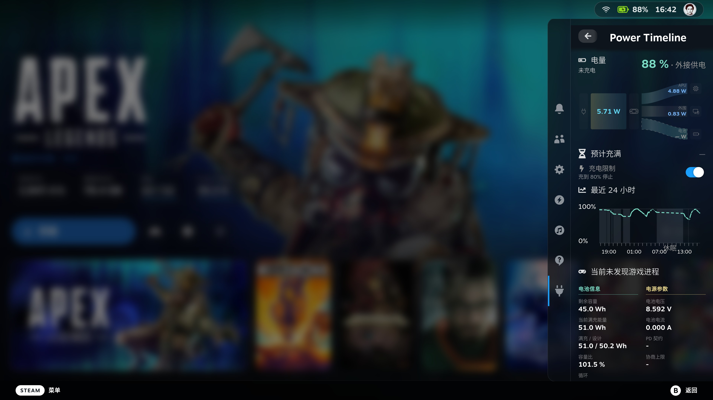

<h1 align="center">Power Timeline</h1>

> A battery record for Steam Deck. See current use in the Quick Access menu, and look back at earlier use.

<p align="center">
  <a href="./README.md">English</a> · <a href="./README.zh-CN.md">简体中文</a> · <a href="./README.pt.md">Português</a> · <a href="./README.es.md">Español</a> · <a href="./README.ja.md">日本語</a> · <a href="./README.ko.md">한국어</a>
</p>
<p align="center">
  <a href="#what">What it does</a> · <a href="#install">Install</a> · <a href="#try-it">How to use it</a> · <a href="#language">Language</a> · <a href="#limits">Please note</a> · <a href="./CHANGELOG.md">Changelog</a>
</p>
<p align="center">
  
</p>

<h2 id="what">What it does</h2>

A Decky plugin. It records battery level, whole-device power, and each game's energy. Closing the page does not stop the record.

From the Quick Access menu:

- Current battery and a small power-flow picture
- The last 24 hours; confirm opens the timeline
- While charging, about how long until full
- The charge limit already saved in Steam
- Power flow, power and battery, and game history

The timeline shows the last 1, 3, or 7 days. Left, right, or a sideways drag stops on one moment.

<h2 id="install">Install</h2>

Install Decky. Download the latest ZIP from [Releases](https://github.com/ZacharyQin/power-timeline/releases/latest), then install that ZIP in Decky. Decky lists **Power Timeline**.

The backend runs as root so it can read hardware. It does not change system power policy or other plugins.

To update, download the new ZIP from the same Releases page and install it again. Uninstalling does not delete history. It is usually in `~/homebrew/data/power-timeline/`.

<details>
<summary>Build from source</summary>

Node.js, pnpm, and Python 3 are required.

```sh
pnpm install --registry=https://registry.npmjs.org
pnpm typecheck
pnpm build
python3 -m unittest discover -s tests -v
```

`pnpm build` writes the frontend. Pack the runtime files into the ZIP. Do not put the database in the plugin directory.

</details>

<h2 id="try-it">How to use it</h2>

1. Open Decky → **Power Timeline**. Start with the battery and the small power-flow picture.
2. Focus the 24-hour chart and press confirm. Switch the last 1, 3, or 7 days at the top.
3. Move onto the chart. Left, right, or a sideways drag picks a moment. The chart shows battery and power then, plus the game icon and name if a game was being watched.
4. While charging, you can see about how long until full. The charge limit uses the percentage already saved in Steam.
5. Confirm the small power-flow picture to open power flow. Confirm the battery block to open power and battery.

The first open has no earlier history. It does not fill in use from before it was turned on.

<h2 id="language">Language</h2>

It follows Steam until you choose. Flags sit at the bottom of the Quick Access menu and every full page. Left, right, or a sideways swipe only moves the highlight. Confirm switches. The hint is in that flag's language.

| Flag | Interface | Steam language |
| --- | --- | --- |
| China | Simplified Chinese | Simplified, Traditional, and other Chinese |
| United States | English | English, and any language not listed below |
| Portugal | Portuguese | Portuguese and Brazilian Portuguese share this text |
| Spain | Spanish | Spanish and Latin American Spanish share this text |
| Japan | Japanese | Japanese |
| South Korea | Korean | Korean |

The choice is remembered. This document is in the same six languages. Use the links at the top.

<h2 id="limits">Please note</h2>

- While plugged in, whole-device use stays unknown. Charge power is not used instead.
- Game energy is an estimate. Two games at once do not each get a full copy.
- A missing number stays unknown. It is not shown as 0.
- The charge limit only toggles Steam's existing switch. The percentage is still changed in Steam.
- Records stay on the device. They are not uploaded.
- Tried on one Steam Deck (Galileo). Other models are unverified.

## License

[BSD 3-Clause](./LICENSE). Copyright (c) 2026, Zachary. This is an independent plugin, not an official Valve, SteamOS, or Decky project.
