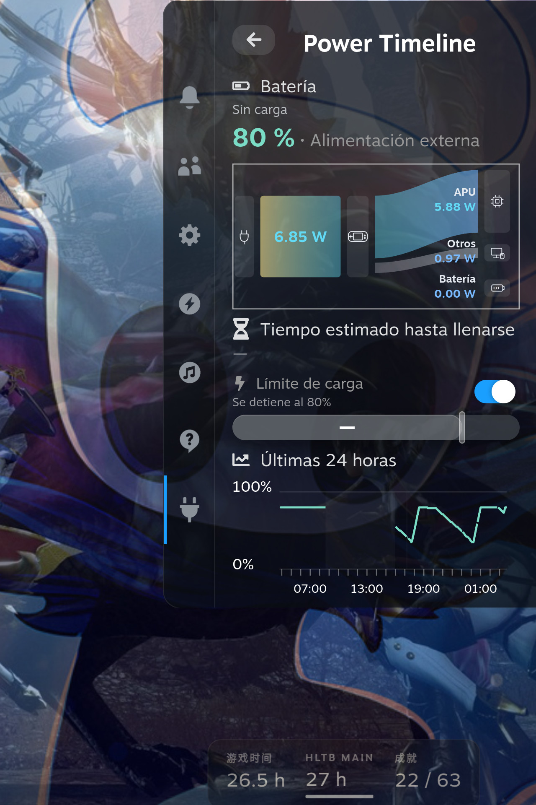

<h1 align="center">Power Timeline</h1>

> “¿La batería de mi Steam Deck ha perdido capacidad? ¿Cuánta energía puede almacenar ahora con una carga completa?”
>
> “¿En qué se ha gastado la batería? ¿Cuánto se gastó al dejar la Steam Deck sin usar y cuánto al jugar?”

Power Timeline es un plugin de Decky para Steam Deck. Permite comparar la capacidad de carga completa de la batería con su capacidad de diseño y reúne el nivel de batería, la actividad de los juegos y los periodos de suspensión en una misma línea temporal. Mira cuánta energía puede almacenar ahora la batería y vuelve atrás para ver cuándo se gastó la carga. Cerrar la página no detiene el registro.

<p align="center">
  <a href="../../README.md">English</a> · <a href="./README.zh-CN.md">简体中文</a> · <a href="./README.pt.md">Português</a> · <a href="./README.es.md">Español</a> · <a href="./README.ja.md">日本語</a> · <a href="./README.ko.md">한국어</a>
</p>
<p align="center">
  <a href="#what">Qué ves</a> · <a href="#install">Instalar</a> · <a href="#try-it">Primer uso</a> · <a href="#limits">Ten en cuenta</a> · <a href="#language">Idioma</a> · <a href="../../CHANGELOG.md">Cambios</a>
</p>
<p align="center">
  
</p>

Esta imagen es el menú de acceso rápido con el aparato enchufado. Muestra la batería actual, el flujo de energía pequeño, el límite de carga de Steam y las últimas 24 horas. Los vatios de la imagen no son la potencia de todo el aparato.

<h2 id="what">Qué ves</h2>

**¿Cuánta energía puede almacenar ahora la batería?**

Compara la capacidad actual de carga completa, la capacidad de diseño y la proporción entre ambas para tener una referencia al comprobar si la batería ha perdido capacidad. Aquí importa cuánto puede almacenar cuando está llena, no cuánta carga le queda en este momento.

**¿Cómo baja la batería al dejar la Steam Deck sin usar y al jugar?**

Revisa el nivel de batería del último día, los últimos 3 días o los últimos 7 días junto con la actividad de los juegos, los cambios de alimentación y los periodos de suspensión. Así puedes ver cuándo bajó más la carga y qué estaba pasando entonces. En los periodos de suspensión puedes comparar la carga antes y después; no hay muestreo continuo ni cálculo de energía durante ese intervalo. El historial de juegos también muestra la estimación de energía de cada juego.

El menú de acceso rápido (QAM) también muestra la carga actual, el flujo de energía pequeño y los detalles de la batería, y permite activar o desactivar el límite de carga de Steam. Mientras carga, cuando el sistema tiene una estimación, también puedes ver aproximadamente cuánto falta para llenarse.

El **Modo de navegación** está debajo de la información de batería en la página de energía y batería, no en QAM, y está desactivado por defecto. Activa primero el límite de Steam, que determina el umbral superior. Con el modo desactivado, ajusta Delta en puntos porcentuales; el umbral inferior se calcula como el superior menos Delta, no se ajusta por separado. Por ejemplo, un límite del 80% y Delta de 10 puntos dan un umbral inferior del 70%. Al activar o reconectar dentro del intervalo, espera; al alcanzar el umbral inferior, solicita carga y la mantiene hasta el superior. No descarga activamente la batería.

El control funciona en segundo plano, sin depender de páginas abiertas. Desactivar el modo o descargar el plugin restaura el límite de hardware anterior; cambiar los ajustes de Steam termina el control sin sobrescribir el nuevo valor. Durante la suspensión solo permanece el último límite de hardware, no un control de dos umbrales en el firmware. La validación física del ciclo completo, suspensión/reanudación y reinicio sigue pendiente; las pruebas unitarias no la sustituyen.

Selecciona **Orden de componentes de QAM** al final para ordenar los 10 componentes en la propia página, sin abrir otra ventana. Usa arriba/abajo para elegir, **A** para levantar, arriba/abajo para mover y **A** para soltar. **B** deshace el movimiento actual; si no hay ningún componente levantado, cancela todo el borrador. **X** guarda y sale; **Y** restaura el orden predeterminado en el borrador. El pie nativo también muestra las teclas equivalentes. Durante la ordenación, el contenido sigue visible pero sus acciones normales están desactivadas; con pantalla táctil o ratón, selecciona el componente y usa sus botones de movimiento. Los componentes ocultos conservan una posición con nombre. El orden guardado permanece en esta Deck y los nuevos componentes se añaden al final.

<h2 id="install">Instalar</h2>

### Instala Decky antes

Si Decky no está instalado, sigue las instrucciones oficiales de [Decky Loader](https://github.com/SteamDeckHomebrew/decky-loader#installation). Las mismas instrucciones están en la [wiki](https://wiki.deckbrew.xyz/en/user-guide/install).

### Descarga el paquete

Abre la [última release](https://github.com/ZacharyQin/power-timeline/releases/latest). Descarga el archivo cuyo nombre empieza por `power-timeline-` y termina en `.zip`. No descargues Source code (zip). Ese archivo es el código fuente, y Decky no puede instalarlo.

Si descargaste el ZIP en otro ordenador, cópialo a la Steam Deck.

### Instálalo en Decky

Los nombres de abajo son los de la interfaz de Decky en español. Este plugin no está en la tienda, así que se instala desde un ZIP.

1. Pulsa el botón de acceso rápido, abre el menú y ve al icono del enchufe. El título debe decir Decky. Si ya estás dentro de un plugin, pulsa la flecha a la izquierda del título hasta que diga Decky.
2. Elige el engranaje. La indicación es «Abrir los ajustes de Decky».
3. Abre General. En Otros, activa Modo desarrollador.
4. Desarrollador aparece entonces en la lista de la izquierda. Ábrelo.
5. En Plugins de terceros, busca Instalar plugin desde archivo ZIP y elige Navegar.
6. El cuadro dice que el equipo de Decky no ha revisado este plugin. La primera vez, espera unos 5 segundos antes de poder continuar.
7. Elige el ZIP cuyo nombre empieza por `power-timeline-`.

Cuando esté instalado, vuelve a la lista bajo el icono del enchufe y abre **Power Timeline**.

El servicio se ejecuta como root para leer el hardware. No cambia por su cuenta la política de energía del sistema, ni modifica los demás plugins.

### Actualizar y desinstalar

Para actualizar, descarga el ZIP `power-timeline-` nuevo en la misma página de la última release e instálalo otra vez con los pasos de arriba.

La desinstalación se hace en Plugins, dentro de los ajustes de Decky. Desinstalar no borra el historial. El historial suele estar en `~/homebrew/data/power-timeline/`. Para borrar también el historial, puedes borrar esa carpeta de datos.

El historial usa columnas numéricas nativas de SQLite, un diccionario de texto y tablas relacionales de errores y motivos, en lugar de JSON por muestra. Al actualizar una base JSON antigua, se valida una base nueva separada y se conserva una copia completa `timeline.pre-typed-*.sqlite3` antes del cambio atómico, sin reducir la precisión. Desde 0.3.3, la base activa tiene un límite de 256 MiB: al llenarse elimina el lote más antiguo por orden de registro y sus datos relacionados, reutiliza las páginas libres y sigue grabando. Las sesiones recortadas se indican como parciales y solo suman los intervalos conservados; se conserva la última muestra. Las copias de seguridad no se borran automáticamente; estas y los diarios de transacciones ocupan espacio adicional. Antes de volver a una versión antigua, detén el plugin y restaura también la base anterior correspondiente, no solo el código.

<h2 id="try-it">Primer uso</h2>

1. Abre el menú de acceso rápido, ve al icono del enchufe y elige **Power Timeline**.
2. Lleva el foco a Últimas 24 horas y pulsa el botón de confirmar (A) para abrir la línea temporal de la batería.
3. Arriba de la página, elige Último día, Últimos 3 días o Últimos 7 días. Lleva el foco a la curva y usa izquierda y derecha para ver un momento. El gráfico muestra la batería y la potencia de ese momento. Si había un juego registrado, aparecen su icono y su nombre.
4. Elige Historial de juegos.
5. De vuelta en el menú de acceso rápido, enfoca el flujo de energía pequeño y pulsa confirmar para abrir el flujo de energía. Enfoca Batería y pulsa confirmar para abrir energía y batería.

La primera vez no hay historial anterior. El uso de antes de encender el plugin no se rellena.

<details>
<summary>Pantalla táctil y otros controles</summary>

- Toca Últimas 24 horas para abrir la línea temporal. Toca el flujo de energía pequeño para abrir el flujo de energía. Toca Batería para abrir energía y batería.
- Izquierda y derecha en el gráfico de 24 horas del menú de acceso rápido solo marcan un momento temporal. No abren la línea temporal.
- En la curva de la línea temporal, un arrastre horizontal elige un momento. Un toque sin arrastre no elige.

</details>

<h2 id="limits">Ten en cuenta</h2>

- La potencia de todo el aparato solo existe cuando se confirma que la batería se está descargando. Enchufado, queda desconocida. La potencia de carga, la potencia neta de la batería y la potencia de la APU no ocupan su lugar.
- La energía de los juegos es una estimación. Dos juegos a la vez no reciben cada uno el total del aparato.
- Un número que falta sigue siendo desconocido. No se muestra como 0. El tiempo hasta llenarse sale de la estimación del sistema. No es una cuenta exacta.
- El límite de carga solo enciende o apaga el interruptor que ya existe en Steam. El porcentaje se sigue cambiando en Steam.
- Los registros se quedan en el aparato. No se envían.
- Probado en una Steam Deck (Galileo). Los demás modelos no están verificados.

<details>
<summary>Qué incluye la estimación de energía</summary>

La estimación de energía del juego cubre la energía de CPU y GPU que se puede repartir según la actividad de los procesos. No es la energía de todo el aparato al ejecutar ese juego. No incluye la pantalla, la potencia del SoC leída aparte, ni el uso del sistema que no se asignó a ese juego.

</details>

<h2 id="language">Idioma</h2>

Sigue el idioma de la interfaz de Steam hasta que elijas uno.

Puedes elegir chino simplificado, inglés, portugués, español, japonés y coreano. Por defecto, las banderas aparecen cerca del final del menú de acceso rápido; en las páginas completas siguen al final. Izquierda, derecha o un deslizamiento horizontal solo mueven el resalte. Confirmar cambia el idioma. La frase usa el idioma de esa bandera. La elección se recuerda.

Este documento existe en los mismos seis idiomas. Usa los enlaces de arriba.

<details>
<summary>Cómo corresponden los idiomas de Steam</summary>

| Bandera | Interfaz | Idioma de Steam |
| --- | --- | --- |
| China | Chino simplificado | Simplificado, tradicional y otros chinos |
| Estados Unidos | Inglés | Inglés, y cualquier idioma no listado abajo |
| Portugal | Portugués | El portugués y el portugués de Brasil comparten este texto |
| España | Español | El español y el español latinoamericano comparten este texto |
| Japón | Japonés | Japonés |
| Corea del Sur | Coreano | Coreano |

</details>

<details>
<summary>Compilar desde el código</summary>

Hacen falta Node.js, pnpm y Python 3.

```sh
pnpm install --registry=https://registry.npmjs.org
pnpm typecheck
pnpm build
python3 -m unittest discover -s tests -v
```

`pnpm build` genera la interfaz. Mete los archivos de ejecución en el ZIP antes de instalar. No pongas la base de datos en la carpeta del plugin.

</details>

## Licencia

[BSD 3-Clause](../../LICENSE). Copyright (c) 2026, Zachary. Este es un plugin independiente, no un proyecto oficial de Valve, SteamOS o Decky.
