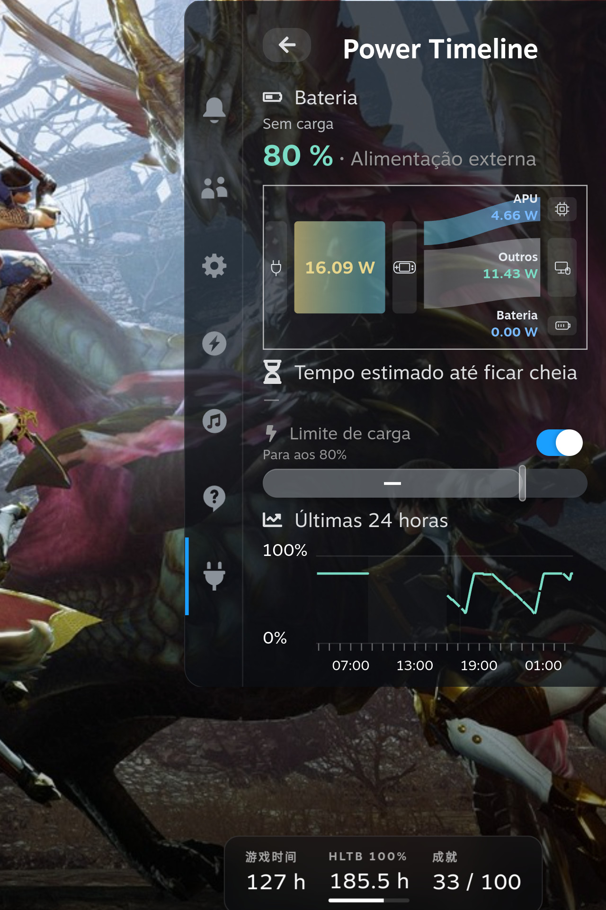

<h1 align="center">Power Timeline</h1>

> “A bateria da minha Steam Deck perdeu capacidade? Quanta energia consegue guardar agora com uma carga completa?”
>
> “Para onde foi a carga da bateria? Quanto se gastou com a Steam Deck parada e quanto a jogar?”

O Power Timeline é um plugin Decky para a Steam Deck. Permite comparar a capacidade de carga completa da bateria com a capacidade de projeto e reúne o nível da bateria, a atividade dos jogos e os períodos de suspensão numa só linha temporal. Vê quanta energia a bateria consegue guardar agora e volta atrás para perceber quando a carga foi gasta. Fechar a página não pára o registo.

<p align="center">
  <a href="../../README.md">English</a> · <a href="./README.zh-CN.md">简体中文</a> · <a href="./README.pt.md">Português</a> · <a href="./README.es.md">Español</a> · <a href="./README.ja.md">日本語</a> · <a href="./README.ko.md">한국어</a>
</p>
<p align="center">
  <a href="#what">O que vês</a> · <a href="#install">Instalar</a> · <a href="#try-it">Primeira utilização</a> · <a href="#limits">Tenha em atenção</a> · <a href="#language">Idioma</a> · <a href="../../CHANGELOG.md">Registo</a>
</p>
<p align="center">
  
</p>

Esta imagem é o menu de acesso rápido com o aparelho ligado à corrente. Mostra a bateria atual, o fluxo de energia pequeno, o limite de carga do Steam e as últimas 24 horas. Os watts da imagem não são a potência de todo o aparelho.

<h2 id="what">O que vês</h2>

**Quanta energia consegue a bateria guardar agora?**

Compara a capacidade atual de carga completa, a capacidade de projeto e a relação entre ambas para teres uma referência ao verificar se a bateria perdeu capacidade. O que interessa aqui é quanto consegue guardar quando está cheia, não a carga que resta neste momento.

**Como se gasta a bateria com a Steam Deck parada e a jogar?**

Revê o nível da bateria no último dia, nos últimos 3 dias ou nos últimos 7 dias, juntamente com a atividade dos jogos, as mudanças de alimentação e os períodos de suspensão. Assim podes ver quando a carga caiu mais e o que estava a acontecer. Nos períodos de suspensão, podes comparar a carga antes e depois; não há amostragem contínua nem cálculo de energia durante esse intervalo. O histórico de jogos também mostra a estimativa de energia de cada jogo.

No menu de acesso rápido (QAM) também vês a carga atual, o fluxo de energia pequeno e os detalhes da bateria, e podes ligar ou desligar o limite de carga da Steam. Durante o carregamento, quando o sistema tem uma estimativa, também podes ver aproximadamente quanto falta até ficar cheia.

O **Modo de navegação** fica abaixo das informações da bateria na página de energia e bateria, não no QAM, e está desligado por predefinição. Ativa primeiro o limite da Steam, que define o limiar superior. Com o modo desligado, ajusta Delta em pontos percentuais; o limiar inferior é calculado como o superior menos Delta, não é definido separadamente. Por exemplo, um limite de 80% e Delta de 10 pontos dão um limiar inferior de 70%. Ao ativar ou voltar a ligar a alimentação dentro do intervalo, espera; ao atingir o limiar inferior, pede carga e mantém-na até ao superior. Não descarrega ativamente a bateria.

O controlo corre em segundo plano, independentemente das páginas abertas. Desligar o modo ou descarregar o plugin restaura o limite de hardware anterior; mudar as definições da Steam termina o controlo sem substituir o novo valor. Durante a suspensão fica apenas o último limite de hardware, não um controlo de dois limiares no firmware. A validação física do ciclo completo, suspensão/retoma e reinício continua pendente; os testes unitários não a substituem.

Seleciona **Ordem dos componentes do QAM** no fundo para ordenar os 10 componentes na própria página, sem abrir outra janela. Usa cima/baixo para escolher, **A** para pegar, cima/baixo para mover e **A** para largar. **B** desfaz o movimento atual; sem componente levantado, cancela todo o rascunho. **X** guarda e sai; **Y** repõe a ordem predefinida no rascunho. O rodapé nativo também mostra as teclas equivalentes. Durante a ordenação, o conteúdo continua visível, mas as ações normais ficam desativadas; com toque ou rato, seleciona o componente e usa os botões de movimento no próprio bloco. Os componentes ocultos mantêm uma posição identificada. A ordem guardada fica nesta Deck e os novos componentes são acrescentados no fim.

O **Controlo da ventoinha** partilha o componente da curva existente no QAM: um título com o ícone da ventoinha e apenas dois separadores, **Automático do sistema** e **Velocidade máxima**. Não mostra indicações L1/R1, lista pendente, linha de RPM ou parágrafo explicativo. Esquerda/direita apenas move o foco; prime **A** para confirmar o modo. O gráfico completo só aparece no modo automático confirmado e fica oculto no máximo; mover o foco não altera a sua visibilidade. A posição guardada mantém-se. O máximo pede 7300 RPM, sem garantir uma leitura medida idêntica.

O máximo continua com o QAM fechado. Selecionar automático ou descarregar o plugin restaura o modo automático anterior do sistema ou do EC. Um processo systemd independente e a limpeza de saída tratam da perda do backend; o modo de transferência de baixo consumo e os controladores externos detetados têm prioridade. A curva oficial e a ativação do serviço não são alteradas. Um bloqueio de atraso do logind pede a reposição antes de suspender; o máximo nunca é retomado automaticamente após reiniciar. A validação de suspensão/reinício controlados e dos comandos físicos/ecrã tátil continua pendente.

<h2 id="install">Instalar</h2>

### Instalar o Decky primeiro

Se o Decky não estiver instalado, segue as instruções oficiais do [Decky Loader](https://github.com/SteamDeckHomebrew/decky-loader#installation). As mesmas instruções estão na [wiki](https://wiki.deckbrew.xyz/en/user-guide/install).

### Descarregar o pacote

Abre a [release mais recente](https://github.com/ZacharyQin/power-timeline/releases/latest). Descarrega o ficheiro cujo nome começa por `power-timeline-` e acaba em `.zip`. Não descarregues Source code (zip). Esse arquivo é o código-fonte, e o Decky não o instala.

Se descarregaste o ZIP noutro computador, copia-o para a Steam Deck.

### Instalar no Decky

Os nomes abaixo são os do Decky em português de Portugal. Se o Decky estiver em português do Brasil, o texto do mesmo item pode diferir. Este plugin não está na loja, por isso instala-se a partir de um ZIP.

1. Prime o botão de acesso rápido, abre o menu e vai ao ícone da ficha. O título deve dizer Decky. Se já estiveres dentro de um plugin, prime a seta à esquerda do título até aparecer Decky.
2. Escolhe a engrenagem. A indicação é «Abrir as Definições Decky».
3. Abre Geral. Em Outros, liga o Modo de programador.
4. Programador passa a aparecer na lista à esquerda. Abre-o.
5. Em Plugins de terceiros, encontra Instalar plugin a partir de um ficheiro ZIP e escolhe Navegar.
6. A caixa diz que a equipa do Decky não reviu este plugin. Da primeira vez, espera cerca de 5 segundos antes de continuares.
7. Escolhe o ZIP cujo nome começa por `power-timeline-`.

Depois de instalado, volta à lista sob o ícone da ficha e abre **Power Timeline**.

O serviço corre como root para ler o hardware. Não altera sozinho a política de energia do sistema, nem mexe nos outros plugins.

### Atualizar e desinstalar

Para atualizar, descarrega o novo ZIP `power-timeline-` na mesma página da release mais recente e instala-o outra vez com os passos acima.

A desinstalação faz-se em Plugins, nas definições do Decky. Desinstalar não apaga o histórico. O histórico fica normalmente em `~/homebrew/data/power-timeline/`. Para apagar também o histórico, podes apagar essa pasta de dados.

O histórico usa colunas numéricas nativas de SQLite, um dicionário de texto e tabelas relacionais de erros e motivos, em vez de JSON por amostra. Ao atualizar uma base JSON antiga, valida uma nova base separada e guarda uma cópia completa `timeline.pre-typed-*.sqlite3` antes da troca atómica, sem reduzir a precisão. Desde 0.3.3, a base ativa tem um limite de 256 MiB: quando fica cheia, remove o lote mais antigo por ordem de registo e os dados relacionados, reutiliza as páginas livres e continua a registar. As sessões cortadas são indicadas como parciais e só somam os intervalos conservados; mantém-se a última amostra. As cópias de segurança não são apagadas automaticamente; estas e os diários de transações ocupam espaço adicional. Para voltar a uma versão antiga, para o plugin e restaura também a base antiga correspondente, não apenas o código.

<h2 id="try-it">Primeira utilização</h2>

1. Abre o menu de acesso rápido, vai ao ícone da ficha e escolhe **Power Timeline**.
2. Põe o foco em Últimas 24 horas e prime o botão de confirmar (A) para abrir a linha temporal da bateria.
3. No topo da página, escolhe Último dia, Últimos 3 dias ou Últimos 7 dias. Põe o foco na curva e usa esquerda e direita para ver um momento. O gráfico mostra a bateria e a potência desse momento. Se havia um jogo a ser registado, aparecem o ícone e o nome.
4. Escolhe Histórico de jogos.
5. De volta ao menu de acesso rápido, foca o fluxo de energia pequeno e prime confirmar para abrir o fluxo de energia. Foca Bateria e prime confirmar para abrir energia e bateria.

Na primeira vez não há histórico anterior. O uso de antes de ligar o plugin não é preenchido.

<details>
<summary>Ecrã tátil e outros controlos</summary>

- Toca em Últimas 24 horas para abrir a linha temporal. Toca no fluxo de energia pequeno para abrir o fluxo de energia. Toca em Bateria para abrir energia e bateria.
- Esquerda e direita no gráfico de 24 horas do menu de acesso rápido só marcam um momento temporário. Não abrem a linha temporal.
- Na curva da linha temporal, um arrasto na horizontal escolhe um momento. Um toque sem arrasto não escolhe.

</details>

<h2 id="limits">Tenha em atenção</h2>

- A potência de todo o aparelho só existe quando a descarga da bateria está confirmada. Ligado à corrente, fica desconhecida. A potência de carga, a potência líquida da bateria e a potência da APU não ocupam o lugar.
- A energia dos jogos é uma estimativa. Dois jogos ao mesmo tempo não recebem cada um o total do aparelho.
- Um número em falta continua desconhecido. Não aparece como 0. O tempo até ficar cheia vem da estimativa do sistema. Não é uma contagem exata.
- O limite de carga só liga ou desliga o interruptor já existente na Steam. A percentagem continua a alterar-se na Steam.
- Os registos ficam no aparelho. Não são enviados.
- Experimentado numa Steam Deck (Galileo). Os outros modelos não foram verificados.

<details>
<summary>O que a estimativa de energia inclui</summary>

A estimativa de energia do jogo cobre a energia de CPU e GPU que pode ser repartida pela atividade dos processos. Não é a energia de todo o aparelho ao correr esse jogo. Não inclui o ecrã, a potência do SoC lida à parte, nem o uso do sistema que não foi atribuído a esse jogo.

</details>

<h2 id="language">Idioma</h2>

Segue o idioma da interface da Steam até escolheres um.

Podes escolher chinês simplificado, inglês, português, espanhol, japonês e coreano. Por predefinição, as bandeiras ficam perto do fundo do menu de acesso rápido; nas páginas completas continuam no fundo. Esquerda, direita ou um deslize horizontal só movem o destaque. Confirmar muda o idioma. A frase usa o idioma dessa bandeira. A escolha fica guardada.

Este documento existe nas mesmas seis línguas. Usa as ligações no topo.

<details>
<summary>Como as línguas da Steam correspondem</summary>

| Bandeira | Interface | Língua da Steam |
| --- | --- | --- |
| China | Chinês simplificado | Simplificado, tradicional e outros chineses |
| Estados Unidos | Inglês | Inglês, e qualquer língua não listada abaixo |
| Portugal | Português | Português e português do Brasil partilham este texto |
| Espanha | Espanhol | Espanhol e espanhol latino-americano partilham este texto |
| Japão | Japonês | Japonês |
| Coreia do Sul | Coreano | Coreano |

</details>

<details>
<summary>Compilar a partir do código</summary>

São necessários Node.js, pnpm e Python 3.

```sh
pnpm install --registry=https://registry.npmjs.org
pnpm typecheck
pnpm build
python3 -m unittest discover -s tests -v
```

`pnpm build` gera a interface. Mete os ficheiros de execução no ZIP antes de instalar. Não ponhas a base de dados na pasta do plugin.

</details>

## Licença

[BSD 3-Clause](../../LICENSE). Copyright (c) 2026, Zachary. Este é um plugin independente, não um projeto oficial da Valve, do SteamOS ou do Decky.
