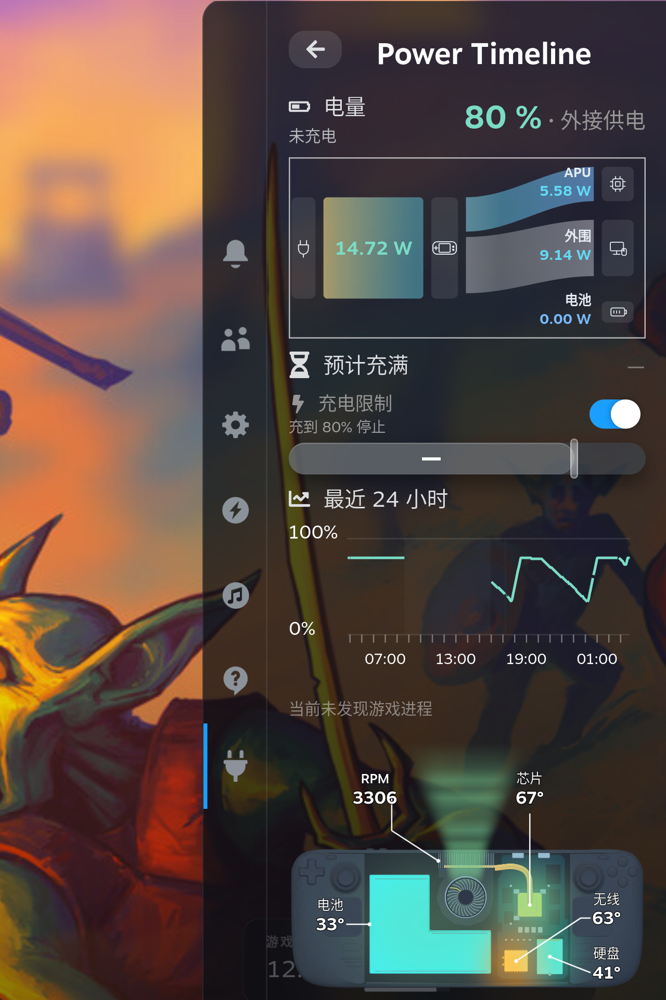

<h1 align="center">Power Timeline</h1>

> “我的 Steam Deck 电池是不是衰减了？现在充满还能存多少电？”
>
> “电量都用到哪儿去了？放着掉了多少，玩游戏又用了多少？”

Power Timeline 是 Steam Deck 上的 Decky 插件。它让你对照电池的满充容量与设计容量，也把电量变化、游戏运行和休眠时段放在同一条时间线上。看看电池现在还能装多少电，再回头看看，这些电是什么时候用掉的。关掉页面以后，记录仍会继续。

<p align="center">
  <a href="../../README.md">English</a> · <a href="./README.zh-CN.md">简体中文</a> · <a href="./README.pt.md">Português</a> · <a href="./README.es.md">Español</a> · <a href="./README.ja.md">日本語</a> · <a href="./README.ko.md">한국어</a>
</p>
<p align="center">
  <a href="#what">能看到什么</a> · <a href="#install">安装</a> · <a href="#try-it">第一次使用</a> · <a href="#limits">请注意</a> · <a href="#language">语言</a> · <a href="../../CHANGELOG.md">更新记录</a>
</p>
<p align="center">
  
</p>

这张图是插着电源时的快捷访问菜单。能看到当前电量、功率流小图、Steam 充电限制和最近 24 小时。图里的瓦数不是整机功率。

<h2 id="what">能看到什么</h2>

**电池现在还能装多少电？**

对照当前满充容量、设计容量和容量比，为判断电池容量有没有衰减提供参考。这里关心的是充满后能装下多少电，而不是此刻剩余多少电。

**放着、玩游戏时，电量分别怎么掉的？**

回看最近 1、3、7 天的电量曲线，对照游戏运行、供电变化和休眠时段，看看哪一段掉电明显，当时在做什么。休眠区间可以对照前后电量，期间不连续采样，也不补算耗电。游戏记录里还可以查看各游戏的用电估算。

快捷访问菜单（QAM）里还能看当前电量、功率流小图和电池信息，也可以开启或关闭 Steam 的充电限制。正在充电、并且系统给出估计时，还能看到大约还要多久充满。

**航行模式**位于**电源与电池**内页的电量信息下方，不在 QAM 展示，默认关闭。先开启 Steam 充电限制，其限额作为上限；关闭航行模式后设置差异值 Delta（百分点），充电下限自动等于上限减去 Delta，不单独设置。例如上限 80%、Delta 为 10 个百分点时，下限为 70%。区间内启用或重新接电时等待，电量降至下限或以下才请求充电，随后持续充至上限，不主动放电。

控制器在后台运行，不依赖页面常开。关闭模式或卸载运行中的插件时恢复接管前的硬件限额；修改 Steam 充电设置则退出接管，不覆盖新设置。休眠时仅保留最后写入的硬件上限，不等于固件双阈值控制。完整的真实充电循环、休眠唤醒和重启验收仍待完成，单元测试不能替代这些实机证据。

在底部选择 **QAM 组件顺序**，直接在 QAM 原页面调整全部 10 个展示块，不另开弹窗。上下选择组件，按 **A** 抬起，上下移动，再按 **A** 放下。**B** 撤销本次抬起移动；未抬起时取消整次排序。**X** 保存并退出，**Y** 将草稿恢复默认，键盘对应操作由原生底栏提示。排序时保留组件原貌，但禁用其原有操作；触摸或鼠标可点选组件，再用块内的移动按钮。暂时隐藏的组件保留带名称的位置。保存后在本机记住，新增组件追加在已保存顺序的末尾。

**风扇控制**与原有风扇曲线共用 QAM 中的同一个组件：带风扇图标的标题下仅有**系统自动**、**最大转速**两个 Tab，不显示 L1/R1 提示、下拉框、转速读数或解释段落。左右只移动焦点，按 **A** 确认后才切档。完整匹配图仅在已确认的系统自动模式下显示，最大档隐藏；只移动焦点不会改变图表显隐。已保存的组件位置不变。最大档请求 7300 RPM，不保证实测转速与目标相同。

关闭 QAM 后最大档继续运行；切回自动或卸载插件时恢复接管前的 OS 或 EC 自动模式。独立 systemd 工作进程与退出清理处理后台连接丢失；低功耗下载模式及检测到的外部控制器优先，不反复抢写。不会修改官方曲线或服务启用策略。休眠前通过 logind 延迟锁请求恢复，重启后不会自动重放最大档；受控休眠、整机重启及实体手柄／触屏验收仍待完成。

<h2 id="install">安装</h2>

### 先安装 Decky

还没有 Decky 的话，先按官方说明安装 [Decky Loader](https://github.com/SteamDeckHomebrew/decky-loader#installation)。同一份说明也在 [wiki](https://wiki.deckbrew.xyz/en/user-guide/install)。

### 下载安装包

打开 [最新 Release](https://github.com/ZacharyQin/power-timeline/releases/latest)。下载文件名以 `power-timeline-` 开头、以 `.zip` 结尾的安装包。不要下载页面上的 Source code (zip)。那是源码，不能装进 Decky。

如果这个 ZIP 是在另一台电脑上下的，先把它拷到 Steam Deck 上。

### 在 Decky 里安装

下面的菜单名是 Decky 简体中文界面里的原文。这个插件还不在商店里，所以要从 ZIP 安装。

1. 按快捷访问键，打开快捷访问菜单，移到插头图标。标题应是 Decky。如果已经停在某个插件里，先按标题左侧的箭头，回到 Decky 这个标题。
2. 选齿轮。提示是「打开 Decky 设置」。
3. 打开「通用」。在「其他」里打开「开发者模式」。
4. 左侧这时会出现「开发者」。打开它。
5. 在「第三方插件」里找到「从 ZIP 压缩文件安装插件」，选「浏览文件」。
6. 对话框会说明 Decky 没有审核这个插件。第一次要等大约 5 秒才能继续。
7. 选中以 `power-timeline-` 开头的那个 ZIP。

装好以后，回到插头图标下的列表，打开 **Power Timeline**。

后端以 root 运行，用来读硬件。它不会自己改系统电源策略，也不会改其它插件。

### 更新和卸载

更新时，从同一个最新 Release 页面下载新的 `power-timeline-` ZIP，再按上面的步骤装一次。

卸载在 Decky 设置的「插件」里进行。卸载不删除历史。历史一般在 `~/homebrew/data/power-timeline/`。如需同时清除历史记录，可删除该数据目录。

历史使用 SQLite 原生数值列、字符串字典及错误／原因关联表，不再逐条保存 JSON。旧 JSON 库首次升级时先生成并检查旁路新库，保留完整 `timeline.pre-typed-*.sqlite3` 备份后原子切换，不降低采样精度。自 0.3.3 起，活动库上限固定为 256 MiB；满额时按入库先后滚动移除最旧的一批记录及关联数据，复用空闲页并继续录制，不再满额停录。被截断的会话标记为部分记录，耗电只统计仍保留的区间；最新采样端点保留。回滚备份不自动删除，备份与事务日志另占磁盘空间。回退旧插件前应停用插件，并同时恢复对应的旧库备份，不能只降级代码。

<h2 id="try-it">第一次使用</h2>

1. 打开快捷访问菜单，移到插头图标，选择 **Power Timeline**。
2. 把焦点移到「最近 24 小时」，按确认键（A），进入电池时间线。
3. 在页面顶部选择「最近 1 天」「最近 3 天」或「最近 7 天」。把焦点移到曲线上，用左右方向键查看某个时刻。图上会显示这一刻的电量和功率；当时有游戏记录，就显示图标和名字。
4. 选择「游戏记录」，打开游戏历史。
5. 回到快捷访问菜单后，选中功率流小图并按确认键，打开功率流。选中「电池信息」并按确认键，打开电源与电池。

第一次启用时没有更早的记录，也不会补上启用之前的用电。

<details>
<summary>触屏与其他操作</summary>

- 点「最近 24 小时」可以进入时间线。点功率流小图可以打开功率流。点「电池信息」可以打开电源与电池。
- 在快捷访问菜单的 24 小时小图上按左右方向键，只会临时标出一个时刻，不会进入时间线。
- 在时间线曲线上，触屏需要横向滑动才会选中时刻。只点一下、不滑动，不会选中。

</details>

<h2 id="limits">请注意</h2>

- 整机功率只在确认电池正在放电时才有。插着电源时，整机功率是未知，不会用充电功率、电池净功率或 APU 的功率来代替。
- 游戏用电是估算。两个游戏同时在跑时，不会各算一份整机用电。
- 没测到的数保持未知，不会显示成 0。充满时间来自系统估计，不是精确倒计时。
- 充电限制只开关 Steam 已有的开关。百分比仍在 Steam 里改。
- 记录留在本机，不上传。
- 只在一台 Steam Deck（Galileo）上试过。其它型号没有验证。

<details>
<summary>用电估算包括什么</summary>

游戏用电估算覆盖可按进程活动分摊的 CPU 和 GPU 能量，不等于运行该游戏时的整机耗电。它不包含屏幕、单独读到的 SoC 功耗，以及没有分到这个游戏的系统用电。

</details>

<h2 id="language">语言</h2>

默认跟随 Steam 的界面语言，直到你自己选一种。

可以选择简体中文、英语、葡萄牙语、西班牙语、日语和韩语。快捷访问菜单默认在靠近底部的位置显示国旗，内页的国旗仍在底部。左右方向键或横向滑动只移动高亮，按确认键才切换。提示用那面旗子的语言。选过以后会记住。

这份说明也是这六种语言，用顶部的链接切换。

<details>
<summary>Steam 语言怎么对应</summary>

| 国旗 | 界面 | Steam 语言 |
| --- | --- | --- |
| 中国 | 简体中文 | 简体、繁体，以及其它中文 |
| 美国 | 英文 | 英文，以及下面没列出的语言 |
| 葡萄牙 | 葡萄牙语 | 葡萄牙语和巴西葡萄牙语共用 |
| 西班牙 | 西班牙语 | 西班牙语和拉美西班牙语共用 |
| 日本 | 日语 | 日语 |
| 韩国 | 韩语 | 韩语 |

</details>

<details>
<summary>从源码构建</summary>

需要 Node.js、pnpm 和 Python 3。

```sh
pnpm install --registry=https://registry.npmjs.org
pnpm typecheck
pnpm build
python3 -m unittest discover -s tests -v
```

`pnpm build` 生成前端。把运行文件打进 ZIP 再安装。不要把数据库放进插件目录。

</details>

## 许可证

[BSD 3-Clause](../../LICENSE)。Copyright (c) 2026, Zachary。这是独立插件，不是 Valve、SteamOS 或 Decky 的官方项目。
